# Goal Model and Sprint Decisions

This file records how the sprint scope was chosen from the goal models and, in later steps, how the goal model changed for the sprint.

- **Interview transcripts (Assignment 1):** [Janelle, rider](interviews/janelle-rider.csv), [Frank, dispatcher](interviews/frank-dispatcher.csv), [Diane, budget manager](interviews/diane-budget-manager.csv)
- **Goal models (Assignment 2):** [`models/hw2-baseline/`](models/hw2-baseline/), with one model per stakeholder plus the [combined model](models/hw2-baseline/goal_model_combined.py) and its [Mermaid diagram link](models/hw2-baseline/mermaid.txt)

Goal IDs (`G-n`), conflict IDs (`C-n`), inconsistency IDs (`I-n`) and use case IDs (`UC-n`) are the ones used in Assignment 2. Goals marked **(inferred)** are not stated in any transcript; they are highlighted yellow in the combined model.

---

## Step 1: Reconciling the models and choosing the sprint scope

### 1.1 Source models and how they were reconciled

I completed this assignment alone, so the models being reconciled are the three stakeholder models I built in Assignment 2, one per interview:

| Model | Stakeholder | Goals | ID range |
|---|---|---|---|
| `goal_model_Janelle.py` | Rider who uses the service five days a week and a larger-than-standard wheelchair | 37 | G-1 to G-37 |
| `goal_model_Frank.py` | Dispatcher with 19 years' experience | 49 | G-38 to G-85, G-145 |
| `goal_model_Diane.py` | Paratransit budget manager | 46 | G-86 to G-123, G-137 to G-144 |
| `goal_model_combined.py` | Merged model | 131 | adds G-124 to G-136 |

Before using the combined model as the basis for the sprint, I checked it against the three individual models again:

- **No goal was lost in the merge.** Fourteen goals from the individual models are missing from the combined model, and each one is a documented merge into a goal that was rewritten to carry both meanings: G-33→G-61, G-34→G-63, G-39 and G-88→G-7, G-43 and G-117→G-3, G-44→G-5, G-46→G-29, G-49→G-32, G-78→G-27, G-80→G-9, G-82→G-98, G-85→G-76, G-118→G-45.
- **The places where the models describe the same thing differently matter for this sprint.** Janelle, Frank and Diane each describe the phone problem from their own role: rider hold time (G-3), routine calls (G-43) and call-center transactions (G-117). The merge combined them into G-3, so one feature that removes avoidable change calls serves all three stakeholders.
- **The two goals the sprint depends on most come from different models and conflict.** Janelle's G-14, an immediate outcome for a change, and Frank's G-73, dispatcher control of same-day changes, are conflict C-1. The resolution, G-125 to G-128, exists only in the combined model. No stakeholder has seen it.
- **The baseline was re-run against the `goalmodeling` package.** The combined model still runs from its new location in this repository and produces the same Mermaid link that was submitted for Assignment 2.

### 1.2 Candidate feature areas

I grouped the combined model into feature areas by the subtree each area satisfies, then scored each area on the three criteria in the assignment.

| # | Feature area | Main goals | Core | User-facing | Uncertainty | Stakeholders |
|---|---|---|---|---|---|---|
| **A** | **Same-day change and cancellation** | G-9 (change part), G-41, G-73, G-125 | **High.** This is Janelle's failure story and Frank's "where the board starts to unravel". | **High.** It covers the rider portal and the dispatcher board. | **High.** Resolving C-1 depends on goals no stakeholder stated. | Janelle, Frank, Diane |
| B | Live van tracking and arrival estimate | G-10, G-20 to G-27 | High for Janelle | High (rider) | High, but technical: is the estimate accurate? | Janelle |
| C | Online booking | G-11, G-15, G-16, G-48, G-134 | Medium. It is a prerequisite, but booking already works by phone the day before. | High (rider) | Low. Booking forms are well understood; the only open question is late requests (C-6). | Janelle, Frank |
| D | Next-day run building and conflict flags | G-45, G-51, G-54 to G-62 | High for Frank | Dispatcher only | Medium | Frank, Diane |
| E | Vehicle matching | G-28, G-31, G-32, G-131 | High for Janelle | Low. It is mostly a back-end rule. | Medium (C-3, fit versus deadhead) | Janelle, Frank, Diane |
| F | Driver manifests and notes | G-29, G-63, G-65, G-68 | Medium | Driver | Low | Frank, Janelle |
| G | Trip-level cost data and reconciliation | G-90, G-98 to G-103, G-121 | High for Diane | Internal staff only | Low to medium (data definitions) | Diane |
| H | No-show and late-cancel patterns | G-42, G-83, G-120 | Low | Dispatcher | Low | Frank, Diane |

### 1.3 Selected scope: same-day change and cancellation (area A)

**Area A is the only one that scores high on all three criteria, and it is the only one that involves all three stakeholders.**

**Core.** It is the problem each stakeholder raised when asked what goes wrong:
- Janelle: "once my workday ended early, I needed to change my pickup that same day, but I was stuck on hold and couldn't get the change made in time" (00:32:01). When asked what matters most, she named the return trip (00:37:23), and a same-day pickup change is what puts the return trip at risk.
- Frank: "Same-day changes are where the board starts to unravel" (00:47:38), and "one person's convenience can put six other pickups outside their window" (00:50:52).
- Diane: "we look first for more accurate scheduling and fewer avoidable phone transactions" (00:59:57), and "every avoidable mile and phone transaction has a budget consequence" (01:03:42).

**User-facing.** It touches two of the three stakeholders directly: the rider submits a change and sees the outcome, and the dispatcher reviews its impact on the run. It also shows the result to the third party involved, the driver, through the manifest.

**Uncertainty.** This is the main reason for the choice. Fifteen of the 25 goals in scope are **(inferred)**. They include the whole C-1 compromise: auto-accept when no one else is affected (G-126), route to the dispatcher otherwise (G-127), and show a pending status (G-128). Specifically:
- Neither Janelle nor Frank has seen the compromise. Janelle asked for "an immediate confirmation instead of guessing what happened". A *pending* status may feel to her like more guessing.
- Frank said "I'd still need control over same-day changes". He may not accept changes being applied without him, even when they affect nobody else.
- "Affects another rider's window or capacity" is not defined. For example, it is unclear whether moving another pickup within its window counts as affecting that rider.
- "Immediate" was interpreted as one minute (G-19). That is my reading, not Janelle's.
- How much of the route impact a rider may see without exposing other riders' details (C-2, G-129 and G-130) is untested.

Each of these is a **requirements** uncertainty: whether the specified behavior is the right behavior. A prototype with mock data can expose them, because they show up as soon as someone uses the screens. Area B is just as uncertain, but in a technical way. Whether an arrival estimate is trustworthy depends on live GPS and traffic data, so a prototype with fake vehicle positions would teach us nothing about it.

#### Goals inside the sprint boundary

Quotes are traced in the Assignment 2 models. "Partial" means only part of the goal's refinement is in scope.

| Goal | Text (combined model) | Source | In scope |
|---|---|---|---|
| **Rider side** | | | |
| G-9 | Rider manages own trips online and makes routine changes without calling | Janelle 00:38:44, Frank 00:50:52 | Partial: change and cancel only, no booking (G-11) |
| G-12 | Rider changes pickup online if workday ends early | Janelle 00:32:01 | Yes |
| G-13 | Rider cancels ride online if ride no longer needed | Janelle 00:32:01 | Yes |
| G-14 | Rider sees outcome or pending status immediately if change submitted | Janelle 00:32:01 (rewritten, inferred) | Yes |
| G-17 | Rider shown confirmation if change accepted | Janelle 00:32:01 | Yes |
| G-18 | Rider shown reason if change not accepted | inferred | Yes |
| G-128 | Rider shown pending status if change awaits dispatcher | inferred (C-1) | Yes |
| G-19 | Outcome or pending status shown within 1 minute of submission | inferred | Yes |
| G-79 | Rider sees effect of change before submitting | Frank 00:50:52 | Yes |
| G-130 | Rider shown only own new window and approval need | inferred (C-2) | Yes |
| G-129 | Avoid: other riders' trip or mobility details disclosed to riders | inferred (C-2) | Yes |
| G-36 | Rider portal conforms to WCAG 2.1 AA | inferred from Janelle 00:36:15 | Yes, for the screens built |
| **Deciding the change** | | | |
| G-125 | Same-day change decided by route impact if rider submits change | inferred (C-1) | Yes |
| G-126 | Change accepted automatically if no other rider window or capacity affected | inferred (C-1) | Yes |
| G-127 | Change routed to dispatcher if another rider window or capacity affected | inferred (C-1) | Yes |
| **Dispatcher side** | | | |
| G-73 | Dispatcher controls same-day changes that affect other riders, capacity or shared routes | Frank 00:50:52 (rewritten, inferred) | Yes |
| G-72 | Whole route impact shown if same-day change affects another rider window or capacity | Frank 00:49:55 (rewritten, inferred) | Partial: without the cost effect (G-132) |
| G-75 | Every affected rider and window shown | Frank 00:47:38 | Yes |
| G-76 | Capacity, mobility needs and pickup windows visible together on one board | Frank 00:49:55 | Yes, for the affected run |
| G-74 | Change applied if dispatcher accepts after seeing impact | Frank 00:47:38 | Yes |
| G-77 | Change history records who changed what and when | Frank 00:47:38, 00:49:55 | Yes |
| **Effect on the run** | | | |
| G-145 | Driver manifest matches accepted changes | inferred (H10) | Yes |
| G-64 | Updated manifest and notes pushed to driver if change accepted | Frank 00:49:55, 00:50:52 | Yes, as a manifest view (no device push) |
| G-67 | Avoid: driver manifest changed if change not accepted | inferred (H10) | Yes |
| G-53 | Trip removed and capacity released if trip cancelled | inferred (H9) | Yes |

**Parent goals the sprint contributes to but does not complete:** G-41 (same-day change applied without cascading delay), G-3 (reduce avoidable calls, call-center transactions and hold time), G-38 (stability of daily runs), G-1 (rider independence and certainty), and G-2 (rider home in time for the attendant's evening visit).

**Dependencies replaced by mock data.** A same-day change only makes sense on top of things the sprint does not build. These are seeded as fixed data rather than implemented:
- trips already booked (G-11, G-15)
- vehicles already matched to riders' mobility needs (G-28, G-32)
- next-day runs already built and free of conflicts (G-45, G-51)
- driver manifests already issued (G-63)

### 1.4 Priorities considered and deferred

Each of these was a reasonable sprint candidate. They are deferred, not removed, and remain in the goal model.

| Deferred | Goals | Why it ranked lower for this sprint |
|---|---|---|
| Live tracking and arrival estimate | G-10, G-20 to G-27 | It matters most to Janelle, and on criteria it comes second to area A. Its uncertainty depends on real GPS and traffic data that mock data cannot reproduce, so V1 would only show a map, not whether the estimate can be trusted. It also serves only one stakeholder. |
| Online booking, including late requests | G-11, G-15, G-16, G-48, G-134, C-6 | Same-day change depends on booking, but booking is the lower-risk half. Riders already book by phone the day before and Janelle described that as working. Booked trips are seeded as mock data instead. |
| Phone channel for riders who cannot use the portal | G-135 | Important for riders who cannot use the portal, but it keeps today's process rather than testing a new one. |
| Next-day run building and conflict flags | G-45, G-51, G-54 to G-62 | High value for Frank, but it is visible only to dispatchers and involves no stakeholder conflict. Built, conflict-free runs are seeded instead. |
| Vehicle matching | G-28, G-31, G-32, G-131, C-3 | Janelle cares about it a great deal, but it is a back-end assignment rule with little to evaluate through an interface. |
| Driver acknowledgement and delivery to devices | G-66, G-84, G-65 | The sprint shows the updated manifest (G-64) but not delivery or acknowledgement. Those need a driver device and timing that mock data cannot represent. |
| Notifying other affected riders | G-27, G-26 | It follows from a dispatcher accepting a change, but needs a notification channel. It is a candidate for a later sprint. |
| Cost effect of a change (Diane's view on the board) | G-132, C-4 | It needs the trip-level cost data in area G, which is out of scope. G-72 is therefore only partly satisfied, and this is recorded rather than hidden. |
| Trip-level cost data, reconciliation, budget, compliance | G-86 subtree (G-87 to G-123, G-136 to G-144) | Diane's goals are real, but none of her interface is rider- or dispatcher-facing. In this sprint she is represented by G-3, fewer avoidable phone transactions, and by the change record (G-77), which is the start of the linked records she wants (G-98). |
| Boarding and driver preparation | G-4, G-29, G-30, G-35, G-133, C-5 | These happen on the road and are carried out by people, not software. A prototype cannot show much about them. |
| No-show patterns, early warnings, board handoff | G-42, G-70, G-71, G-83 | Low uncertainty and dispatcher-only. |
| Attendant-visit timing | G-6, G-8 | Janelle's top priority sits behind G-2, but G-6 and G-8 are inferred, and the Assignment 2 matrix showed no use case step captures the attendant visit time. I left them out of V1 deliberately and will check during evaluation whether the change flow needs them. |

---

## Step 2: Relationships within the sprint scope

### 2.1 The updated goal model

- **Model:** [`models/goal_model_sprint.py`](models/goal_model_sprint.py). It runs against `goalmodeling` 0.1.6 and writes [`models/sprint-mermaid.txt`](models/sprint-mermaid.txt), a mermaid.live link.
- **Colour key:**
  - green: in scope, stated in a transcript
  - yellow: in scope, inferred
  - blue: parent goal the sprint contributes to but does not complete
  - grey (dashed): deferred, kept for context
  - red border: new or rewritten in Assignment 3
- **What it contains:** the sprint boundary from §1.3, one level of deferred context around it so the boundary is visible, every conflict touching the scope, and the decisions below. Deferred subtrees are collapsed to a single grey goal. They are unchanged in the [combined model](models/hw2-baseline/goal_model_combined.py), which stays as the Assignment 2 baseline.
- **Diagram:** rendered below. It is wide, so use GitHub's full-screen or pan controls, or open the [mermaid.live link](models/sprint-mermaid.txt). Conflicts are the edges labelled 🗲. Grey dashed goals are outside the sprint.

```mermaid
flowchart BT
annotationnode105["H12"]:::stroke -.- node105
node105((" ")) ===> node106
node91[/"G-1: Improve rider independence and certainty on daily trips"/] --- node105
annotationnode90["H12"]:::stroke -.- node90
node90((" ")) ===> node91
node86[/"Achieve[G-2: Rider home in time for attendant evening visit]"/] --- node90
node86[/"Achieve[G-2: Rider home in time for attendant evening visit]"/]
node24[/"G-3: Reduce avoidable phone calls, call-center transactions and rider hold time"/] --- node90
annotationnode23["H4"]:::stroke -.- node23
node23((" ")) ===> node24
node21[/"Achieve[G-9: Rider manages own trips online and makes routine changes without calling]"/] --- node23
annotationnode20["H7"]:::stroke -.- node20
node20((" ")) ===> node21
node0[/"Achieve[G-11: Rider books trip online]"/] --- node20
node0[/"Achieve[G-11: Rider books trip online]"/]
node2[/"Achieve[G-12: Rider changes pickup time online <b>If</b> plans change on day of trip]"/]:::bold --- node20
node1{{fa:fa-person Rider}} --- node2
node2[/"Achieve[G-12: Rider changes pickup time online <b>If</b> plans change on day of trip]"/]
node4[/"Achieve[G-13: Rider cancels ride online <b>If</b> ride no longer needed]"/]:::bold --- node20
node3{{fa:fa-person Rider}} --- node4
node4[/"Achieve[G-13: Rider cancels ride online <b>If</b> ride no longer needed]"/]
node13[/"Achieve[G-14: Rider sees outcome or pending status immediately <b>If</b> change submitted]"/] --- node20
annotationnode12["P3"]:::stroke -.- node12
node12((" ")):::filled ===> node13
node6[/"Achieve[G-17: Rider shown confirmation <b>If</b> change accepted]"/]:::bold --- node12
node5{{TripPortal}} --- node6
node6[/"Achieve[G-17: Rider shown confirmation <b>If</b> change accepted]"/]
node8[/"Achieve[G-18: Rider shown reason <b>If</b> change not accepted]"/]:::bold --- node12
node7{{TripPortal}} --- node8
node8[/"Achieve[G-18: Rider shown reason <b>If</b> change not accepted]"/]
node10[/"Achieve[G-128: Rider shown pending status <b>If</b> change awaits dispatcher]"/]:::bold --- node12
node9{{TripPortal}} --- node10
node10[/"Achieve[G-128: Rider shown pending status <b>If</b> change awaits dispatcher]"/]
node11[/"Every submitted change is accepted, not accepted or pending"\]:::bold --- node12

node13[/"Achieve[G-14: Rider sees outcome or pending status immediately <b>If</b> change submitted]"/]
node15[/"Maintain[G-19: Outcome or pending status shown within 1 minute of submission]"/]:::bold --- node20
node14{{TripPortal}} --- node15
node15[/"Maintain[G-19: Outcome or pending status shown within 1 minute of submission]"/]
node19[/"Achieve[G-79: Rider sees effect of change before submitting]"/] --- node20
annotationnode18["H4"]:::stroke -.- node18
node18((" ")) ===> node19
node17[/"Maintain[G-130: Rider shown only own new window and approval need]"/]:::bold --- node18
node16{{TripPortal}} --- node17
node17[/"Maintain[G-130: Rider shown only own new window and approval need]"/]

node19[/"Achieve[G-79: Rider sees effect of change before submitting]"/]

node21[/"Achieve[G-9: Rider manages own trips online and makes routine changes without calling]"/]
node22[/"Achieve[G-10: Rider knows actual vehicle status while waiting]"/] --- node23
node22[/"Achieve[G-10: Rider knows actual vehicle status while waiting]"/]

node24[/"G-3: Reduce avoidable phone calls, call-center transactions and rider hold time"/]
node87[/"Achieve[G-4: Rider boards assigned vehicle safely without rushing]"/] --- node90
node87[/"Achieve[G-4: Rider boards assigned vehicle safely without rushing]"/]
node89[/"G-5: Maximize ability of riders and staff to use system independently and without confusion"/] --- node90
annotationnode88["H3"]:::stroke -.- node88
node88((" ")) ===> node89
node26[/"Maintain[G-36: Rider portal conforms to WCAG 2.1 AA]"/]:::bold --- node88
node25{{TripPortal}} --- node26
node26[/"Maintain[G-36: Rider portal conforms to WCAG 2.1 AA]"/]
node28[/"Achieve[G-37: Rider completes trip tasks without staff help]"/]:::bold --- node88
node27{{fa:fa-person Rider}} --- node28
node28[/"Achieve[G-37: Rider completes trip tasks without staff help]"/]
node32[/"Maintain[G-76: Capacity, mobility needs and pickup windows visible together on one board]"/]:::bold --- node88
node31{{DispatchBoard}} --- node32
node32[/"Maintain[G-76: Capacity, mobility needs and pickup windows visible together on one board]"/]

node89[/"G-5: Maximize ability of riders and staff to use system independently and without confusion"/]

node91[/"G-1: Improve rider independence and certainty on daily trips"/]
node85[/"G-38: Improve stability of daily runs"/] --- node105
annotationnode84["H12"]:::stroke -.- node84
node84((" ")) ===> node85
node73[/"Achieve[G-7: Van arrives within pickup window with stable headway and on-time performance <b>If</b> trip booked]"/] --- node84
annotationnode72["P7"]:::stroke -.- node72
node72((" ")) ===> node73
node71[/"Achieve[G-45: Next-day runs cut accurately and built without conflicts]"/] --- node72
annotationnode70["P1"]:::stroke -.- node70
node70((" ")) ===> node71
node69[/"Maintain[G-50: Run assignments match active trips]"/] --- node70
annotationnode68["H9"]:::stroke -.- node68
node68((" ")) ===> node69
node65[/"Achieve[G-52: Run and driver assigned <b>If</b> trip matched]"/] --- node68
node65[/"Achieve[G-52: Run and driver assigned <b>If</b> trip matched]"/]
node67[/"Achieve[G-53: Trip removed and capacity released <b>If</b> trip cancelled]"/]:::bold --- node68
node66{{DispatchBoard}} --- node67
node67[/"Achieve[G-53: Trip removed and capacity released <b>If</b> trip cancelled]"/]

node69[/"Maintain[G-50: Run assignments match active trips]"/]

node71[/"Achieve[G-45: Next-day runs cut accurately and built without conflicts]"/]
node60[/"Maintain[G-29: Driver prepared and informed of current run]"/] --- node72
annotationnode59["H11"]:::stroke -.- node59
node59((" ")) ===> node60
node58[/"Cease[G-65: Dispatcher phoning drivers to relay changes]"/] --- node59
annotationnode57["H4"]:::stroke -.- node57
node57((" ")) ===> node58
node55[/"Maintain[G-145: Driver manifest matches accepted changes]"/] --- node57
annotationnode54["H10"]:::stroke -.- node54
node54((" ")) ===> node55
node51[/"Achieve[G-64: Updated manifest and notes pushed to driver <b>If</b> change accepted]"/]:::bold --- node54
node50{{DispatchBoard}} --- node51
node51[/"Achieve[G-64: Updated manifest and notes pushed to driver <b>If</b> change accepted]"/]
node53[/"Avoid[G-67: Driver manifest changed <b>If</b> change pending or declined]"/]:::bold --- node54
node52{{DispatchBoard}} --- node53
node53[/"Avoid[G-67: Driver manifest changed <b>If</b> change pending or declined]"/]

node55[/"Maintain[G-145: Driver manifest matches accepted changes]"/]
node56[/"Achieve[G-66: Driver acknowledges updated manifest]"/] --- node57
node56[/"Achieve[G-66: Driver acknowledges updated manifest]"/]

node58[/"Cease[G-65: Dispatcher phoning drivers to relay changes]"/]

node60[/"Maintain[G-29: Driver prepared and informed of current run]"/]

node73[/"Achieve[G-7: Van arrives within pickup window with stable headway and on-time performance <b>If</b> trip booked]"/]
node78[/"Maintain[G-40: Board accurate throughout shift and at handoff]"/] --- node84
annotationnode77["H4"]:::stroke -.- node77
node77((" ")) ===> node78
node75[/"Maintain[G-77: Change history records who changed what and when]"/]:::bold --- node77
node74{{DispatchBoard}} --- node75
node75[/"Maintain[G-77: Change history records who changed what and when]"/]
node76[/"Achieve[G-68: Driver road notes captured in system]"/] --- node77
node76[/"Achieve[G-68: Driver road notes captured in system]"/]

node78[/"Maintain[G-40: Board accurate throughout shift and at handoff]"/]
node82[/"Achieve[G-41: Same-day change applied without cascading delay]"/] --- node84
annotationnode81["H4"]:::stroke -.- node81
node81((" ")) ===> node82
node41[/"Maintain[G-73: Dispatcher controls same-day changes that affect other riders, capacity or shared routes]"/] --- node81
annotationnode40["P4"]:::stroke -.- node40
node40((" ")) ===> node41
node35[/"Achieve[G-72: Whole route impact shown <b>If</b> same-day change affects another rider window or capacity]"/] --- node40
annotationnode34["P5"]:::stroke -.- node34
node34((" ")) ===> node35
node30[/"Achieve[G-75: Every affected rider and window shown]"/]:::bold --- node34
node29{{DispatchBoard}} --- node30
node30[/"Achieve[G-75: Every affected rider and window shown]"/]
node32[/"Maintain[G-76: Capacity, mobility needs and pickup windows visible together on one board]"/]:::bold --- node34
node33[/"Achieve[G-132: Overtime and deadhead effect of a fix shown with route impact]"/] --- node34
node33[/"Achieve[G-132: Overtime and deadhead effect of a fix shown with route impact]"/]

node35[/"Achieve[G-72: Whole route impact shown <b>If</b> same-day change affects another rider window or capacity]"/]
node37[/"Achieve[G-74: Change applied <b>If</b> dispatcher accepts after seeing impact]"/]:::bold --- node40
node36{{fa:fa-person Dispatcher}} --- node37
node37[/"Achieve[G-74: Change applied <b>If</b> dispatcher accepts after seeing impact]"/]
node39[/"Achieve[G-146: Change declined with reason <b>If</b> dispatcher rejects after seeing impact]"/]:::bold --- node40
node38{{fa:fa-person Dispatcher}} --- node39
node39[/"Achieve[G-146: Change declined with reason <b>If</b> dispatcher rejects after seeing impact]"/]

node41[/"Maintain[G-73: Dispatcher controls same-day changes that affect other riders, capacity or shared routes]"/]
node49[/"Achieve[G-125: Same-day change decided by route impact <b>If</b> rider submits change]"/] --- node81
annotationnode48["P3"]:::stroke -.- node48
node48((" ")):::filled ===> node49
node43[/"Achieve[G-126: Change accepted automatically <b>If</b> no other pickup pushed outside its window and no vehicle capacity exceeded]"/]:::bold --- node48
node42{{DispatchBoard}} --- node43
node43[/"Achieve[G-126: Change accepted automatically <b>If</b> no other pickup pushed outside its window and no vehicle capacity exceeded]"/]
node45[/"Achieve[G-127: Change routed to dispatcher <b>If</b> another pickup pushed outside its window or vehicle capacity exceeded]"/]:::bold --- node48
node44{{DispatchBoard}} --- node45
node45[/"Achieve[G-127: Change routed to dispatcher <b>If</b> another pickup pushed outside its window or vehicle capacity exceeded]"/]
node46[/"A change either pushes another pickup outside its window or exceeds capacity, or it does neither"\]:::bold --- node48
node47[/"Removing a stop never pushes a later pickup outside its window (A-4)"\]:::bold --- node48

node49[/"Achieve[G-125: Same-day change decided by route impact <b>If</b> rider submits change]"/]
node64[/"G-148: Minimize driver disruption from mid-run manifest changes"/] --- node81
annotationnode63["H8"]:::stroke -.- node63
node63((" ")) ===> node64
node62[/"Achieve[G-149: Changed stops marked on manifest with time of change]"/]:::bold --- node63
node61{{DriverApp}} --- node62
node62[/"Achieve[G-149: Changed stops marked on manifest with time of change]"/]

node64[/"G-148: Minimize driver disruption from mid-run manifest changes"/]
node79[/"Achieve[G-27: Rider alerted once, before the pickup window opens, <b>If</b> van predicted outside window or trip changes]"/] --- node81
node79[/"Achieve[G-27: Rider alerted once, before the pickup window opens, <b>If</b> van predicted outside window or trip changes]"/]
node80[/"Achieve[G-70: Early warning shown <b>If</b> schedule at risk]"/] --- node81
node80[/"Achieve[G-70: Early warning shown <b>If</b> schedule at risk]"/]

node82[/"Achieve[G-41: Same-day change applied without cascading delay]"/]
node83[/"Achieve[G-42: Repeated no-show and late-cancel patterns visible]"/] --- node84
node83[/"Achieve[G-42: Repeated no-show and late-cancel patterns visible]"/]

node85[/"G-38: Improve stability of daily runs"/]
node104[/"G-86: Maximize responsible use of public funds while keeping service compliant"/] --- node105
annotationnode103["H12"]:::stroke -.- node103
node103((" ")) ===> node104
node102[/"G-93: Maximize favorable variance on cost per trip, overtime and invoices"/] --- node103
annotationnode101["H4"]:::stroke -.- node101
node101((" ")) ===> node102
node100[/"G-109: Minimize cost per passenger trip"/] --- node101
annotationnode99["H4"]:::stroke -.- node99
node99((" ")) ===> node100
node24[/"G-3: Reduce avoidable phone calls, call-center transactions and rider hold time"/] --- node99

node100[/"G-109: Minimize cost per passenger trip"/]

node102[/"G-93: Maximize favorable variance on cost per trip, overtime and invoices"/]
node98[/"Cease[G-90: Manual reconciliation in variance analysis]"/] --- node103
annotationnode97["H4"]:::stroke -.- node97
node97((" ")) ===> node98
node96[/"Achieve[G-103: Trip-level cost allocation data available]"/] --- node97
annotationnode95["P5"]:::stroke -.- node95
node95((" ")) ===> node96
node94[/"Achieve[G-98: Reservation, dispatch, trip, cancellation and no-show records linked and recorded per rider]"/] --- node95
node94[/"Achieve[G-98: Reservation, dispatch, trip, cancellation and no-show records linked and recorded per rider]"/]

node96[/"Achieve[G-103: Trip-level cost allocation data available]"/]

node98[/"Cease[G-90: Manual reconciliation in variance analysis]"/]

node104[/"G-86: Maximize responsible use of public funds while keeping service compliant"/]
node93[/"Avoid[G-129: Other riders' trip or mobility details disclosed to riders]"/] --- node105
annotationnode92["H8"]:::stroke -.- node92
node92((" ")) ===> node93
node17[/"Maintain[G-130: Rider shown only own new window and approval need]"/]:::bold --- node92

node93[/"Avoid[G-129: Other riders' trip or mobility details disclosed to riders]"/]

node106[/"G-124: Maximize reliable, compliant and cost-responsible paratransit service"/]
node107 ---x node82
node107[\"O-3: Rider changes trip without seeing route impact"\]

node19 ---x node107
node19[/"Achieve[G-79: Rider sees effect of change before submitting]"/]
node107[\"O-3: Rider changes trip without seeing route impact"\]

node13 --"#128498;"--- node41
node41[/"Maintain[G-73: Dispatcher controls same-day changes that affect other riders, capacity or shared routes]"/]
node13[/"Achieve[G-14: Rider sees outcome or pending status immediately <b>If</b> change submitted]"/]

node19 --"#128498;"--- node93
node93[/"Avoid[G-129: Other riders' trip or mobility details disclosed to riders]"/]
node19[/"Achieve[G-79: Rider sees effect of change before submitting]"/]

node21 --"#128498;"--- node82
node82[/"Achieve[G-41: Same-day change applied without cascading delay]"/]
node21[/"Achieve[G-9: Rider manages own trips online and makes routine changes without calling]"/]

node51 --"#128498;"--- node64
node64[/"G-148: Minimize driver disruption from mid-run manifest changes"/]
node51[/"Achieve[G-64: Updated manifest and notes pushed to driver <b>If</b> change accepted]"/]


classDef bold stroke-width:3,stroke:#000
classDef filled fill:#000;
classDef nostroke stroke-width:0,fill-opacity:0.0
classDef stroke stroke-dasharray: 5 5,fill-opacity:0.0,text-align:left

    classDef stated fill:#C8E6C9,color:#000
classDef yellow fill:#FFFF00,color:#000
classDef partial fill:#DCEBFA,color:#000
classDef deferred fill:#EEEEEE,color:#777,stroke:#AAA,stroke-dasharray:4 3
classDef changed stroke:#D32F2F,stroke-width:4
class node2,node4,node6,node28,node37,node30,node32,node75,node19,node51,node64 stated
class node13,node8,node15,node26,node67,node53,node35,node41,node49,node43,node45,node10,node93,node17,node55,node39,node62 yellow
class node91,node24,node89,node21,node60,node85,node78,node82,node69,node58,node73,node71,node106 partial
class node86,node87,node22,node0,node79,node83,node65,node56,node76,node80,node94,node96,node98,node100,node102,node104,node33 deferred
class node2,node53,node43,node45,node39,node64,node62 changed
```

<!-- BEGIN sprint goal model (generated by docs/models/goal_model_sprint.py) -->

<!-- END sprint goal model -->

### 2.2 Overlaps

| ID | Requirements | Relationship | Decision | Why |
|---|---|---|---|---|
| OV-1 | G-79 "rider sees effect before submitting" (Frank) and G-14/G-17 "rider sees whether change is accepted" (Janelle) | Both tell the rider about the same change, at different moments: before submission and after. | **Keep separate, build as one flow** (preview → submit → outcome). Both use the same display rule, G-130. | They trace to different stakeholders and answer different questions. Frank wants the rider to understand the change before making it; Janelle wants to know the result. Merging them would lose one of the two traces. |
| OV-2 | G-75 "every affected rider and window shown", G-76 "capacity, mobility and windows together on one board", and the impact test inside G-126/G-127 | The dispatcher's impact view and the automatic decision both depend on the same calculation: which pickups move, and does capacity hold. | **Combine into one impact calculation** that drives both the auto-decision and the dispatcher's view. G-75 and G-76 stay as separate IDs, one for content and one for layout. | If the system decided with one calculation and showed the dispatcher another, the dispatcher could see "no one affected" on a change the system sent for approval, or the reverse. One calculation keeps what Frank sees consistent with what the system decided. |
| OV-3 | G-77 change history (Frank) and G-98 linked reservation, dispatch, cancellation and no-show records (Diane, deferred) | Same events. Frank wants to know "exactly what was changed and when" (00:49:55); Diane wants "cleaner linkage between reservations, dispatch events, completed trips, cancellations, and no-shows" (01:04:24). | **Combine at the data level, prioritize Frank's view.** One change record (trip, who, role, what changed, when, outcome, reason) satisfies G-77 now and is the record G-98 would link later. | This gives Diane a future benefit at no extra cost. Building the reporting side now would pull in the deferred area G. |
| OV-4 | G-3, G-43 and G-117: hold time, routine calls and call-center transactions | Already merged into G-3 in Assignment 2 | **Keep merged** | This overlap is the reason the sprint serves all three stakeholders (§1.1). |

### 2.3 Dependencies

| ID | Dependency | Consequence for the sprint |
|---|---|---|
| DP-1 | G-125, deciding by route impact, needs runs, vehicle capacities, pickup windows and travel times to exist (G-45, G-32, G-28, all deferred). | They are seeded as mock data: one service day, several runs, fixed travel times between stops. This is assumption A-1. |
| DP-2 | **G-18, showing the rider a reason when a change is not accepted, had no supplier for dispatcher decisions.** G-74 covers the dispatcher accepting a change, but nothing in the combined model makes the dispatcher give a reason when declining. | **Added G-146:** "Change declined with reason if dispatcher rejects after seeing impact". It is the converse of G-74 (H10), placed under G-73. Without it, G-18 cannot be satisfied for any change that reaches the dispatcher. |
| DP-3 | G-17 (rider confirmation) and G-64 (driver manifest) are both triggered by the same event: a change being accepted, whether by G-126 or G-74. | **One accept event updates both.** The rider must never see "confirmed" while the driver's manifest still shows the old time, or the reverse. |
| DP-4 | G-67, never changing the manifest unless a change is accepted, interacts with the new pending state (G-128), which did not exist when G-67 was written. | **G-67 rewritten** to "...if change pending or declined". A pending change leaves the original trip and manifest untouched. |
| DP-5 | G-77, the change history, has three writers: the rider (submit), the system (auto-decision) and the dispatcher (accept or decline). | Every state change writes a record with the actor's role, so "who made it" is never blank. Auto-decisions are attributed to "system". |
| DP-6 | G-19 (outcome or pending within one minute) can always be met only because G-128 lets the system answer "pending" while the dispatcher decides. | G-19 holds. But **nothing bounds how long a change may stay pending**. Janelle's failure was precisely that her change wasn't made "in time". This is recorded as open question Q-2, not invented. |
| DP-7 | G-130 limits what the rider sees of the same data G-75 shows the dispatcher. | The impact calculation is computed once (OV-2) and shown through two views by role. The rider view gets only the rider's own trip fields. |
| DP-8 | G-36 (WCAG 2.1 AA) applies to every rider-facing goal: G-12, G-13, G-14, G-17, G-18, G-128 and G-79. | This becomes a quality requirement on the rider screens: keyboard operable, labelled controls, status messages announced to screen readers, sufficient contrast. |
| DP-9 | G-13, cancelling online, feeds Frank's deferred late-cancel patterns (G-42) and Diane's no-show capacity tracking (G-144). | The change record keeps the cancellation time, so a later sprint can classify late cancellations. The sprint does not apply a late-cancel policy, because none was described in the interviews (Q-5). |

### 2.4 Conflicts

Every conflict stays in the model as a `ConflictLink`. None was removed.

#### C-1: Immediate outcome for the rider vs. dispatcher control (G-14 × G-73), carried from Assignment 2

- **Evidence:** Janelle wants to "see whether the change is accepted, and get an immediate confirmation instead of guessing what happened" (00:32:01). Frank says "I'd still need control over same-day changes, vehicle capacity, and shared routes, because one person's convenience can put six other pickups outside their window" (00:50:52).
- **Trade-off:** If every change goes to Frank, Janelle waits for a person and we are back to the phone queue on a screen. Frank warned about exactly that: "it'll just move the confusion from the phone to the screen" (00:51:24). If every change applies automatically, Frank loses the control he asked for, and other riders pay for one rider's convenience.
- **Decision: compromise (kept from Assignment 2).** G-125 decides each change by its route impact. A change that affects no one else is accepted automatically (G-126); a change that does is routed to the dispatcher (G-127), and the rider sees *pending* (G-128).
- **New sub-decision: what "affected" means.** Neither stakeholder defined it. There were two readings:
  1. **Strict:** any shift to another rider's scheduled pickup time counts. Nearly every change on a shared run would go to Frank, and Janelle would rarely get an immediate answer.
  2. **Window-based:** affected only if another pickup is pushed *outside its window*, or vehicle capacity is exceeded.

  **I chose the window-based reading** (assumption A-3, written into G-126/G-127). Frank describes the harm in terms of windows: "put six other pickups outside their window", "put half a route outside its window" (00:46:39). Janelle's goal also needs most isolated changes to be answered immediately. The risk is that Frank also talks about "new pickup-window *risks* for everyone downstream" (00:48:57), which suggests he may want changes that leave a pickup inside its window but at its edge to come to him too. **The prototype will make this visible. It is open question Q-3.**
- **Status: compromise, unvalidated.** Q-1 and Q-2 must be answered by the stakeholders.

#### C-2: Rider sees the effect of a change vs. other riders' privacy (G-79 × G-129), carried from Assignment 2

- **Evidence:** Frank says "The rider should see what they're changing" (00:50:52). Showing the full route impact would reveal other riders' pickup times, addresses or mobility devices.
- **Decision: prioritize privacy, with a partial view.** G-130 shows the rider only their own new window and whether dispatcher approval will be needed, never who or what else is affected.
- **Trade-off accepted:** the rider cannot tell *why* a change needs approval. This is noted as something to watch during evaluation.

#### C-7: Easier self-service vs. stable runs (G-9 × G-41), new

- **Evidence:** Frank names "too many same-day changes hitting the board" as an early sign that "the schedule starts cascading" (00:45:27). On rider self-service he says "it could cut down the routine calls, but if riders change a trip without seeing the route impact, I'd spend more time cleaning up the damage" (00:50:52).
- **The conflict:** a 20-minute hold currently discourages changes. Removing it (G-9) is likely to *increase* the number of same-day changes, which works against G-41 and Frank's board stability. Assignment 2 modelled the second half of Frank's quote as obstacle O-3, resolved by G-79, but not the volume effect.
- **Decision: documented as unresolved.** G-125 limits the damage, because only changes that affect no one apply automatically. But the sprint does not limit how many changes a rider can make or warn when there are too many (G-70, deferred). Choosing a limit would be a policy decision about riders' access to service, which neither the rider nor the dispatcher stated and which Diane's ADA constraint (G-96) bears on. **It needs agency clarification (Q-4).**

#### C-8: Push every accepted change to the driver vs. driver disruption (G-64 × G-148), new

- **Evidence:** Frank wants to "push updated manifests and notes straight to the driver" (00:49:55). In the same interview he says "Drivers get frustrated when the lift schedule and passenger notes change mid-run" (00:48:57). This second statement was **not modelled in Assignment 2**. I found it while tracing G-64 back to the transcript, and added it as **G-148**, a soft goal stated by Frank.
- **The conflict:** auto-acceptance (G-126) means manifests change mid-run without a dispatcher call. That is more disruption, not less.
- **Decision: compromise, G-149.** Changed stops are marked on the manifest with the time of the change, so a driver can see at a glance what moved. Driver acknowledgement (G-66) stays deferred because it needs a driver device.

#### C-4: Dispatcher fixes vs. overtime (G-55 × G-116), carried, outside the sprint

The sprint touches this conflict only through G-132, the cost effect shown with the route impact, which is deferred (§1.4). G-72 is therefore marked *partial* in the model. The conflict stays in the combined model unchanged.

C-3, C-5 and C-6 involve only deferred goals and are unchanged in the combined model.

### 2.5 Assumptions made for the sprint

| ID | Assumption | Relates to |
|---|---|---|
| A-1 | Trips, runs, vehicles and manifests for the service day already exist and are seeded as mock data. Travel times between stops are fixed in a lookup table, with no routing engine. | DP-1 |
| A-2 | "Immediately" means within one minute (G-19, from Assignment 2). In the prototype, the decision is shown as soon as the change is submitted. | G-14, G-19 |
| A-3 | "Affected" means another pickup is pushed outside its window, or a vehicle's seating or wheelchair capacity is exceeded at any point on the run. | C-1, G-126, G-127 |
| A-4 | Cancelling a trip never pushes another pickup outside its window, because a driver who arrives early waits for the window to open. Cancellations are therefore always auto-accepted, and capacity is released (G-53). | G-13, G-125 |
| A-5 | Riders can change the pickup time or cancel. Changing the pickup *address* is out of scope, because Janelle's example was a time change. | G-12 |
| A-6 | G-12's condition "workday ends early" was Janelle's example, not a limit. Any same-day pickup time change, earlier or later, is in scope. | G-12 (rewritten) |
| A-7 | While a change is pending, the original trip stands and the driver's manifest is unchanged. | DP-4, G-67 |
| A-8 | One rider and one dispatcher persona are enough for the prototype. There is no login or authentication; roles are switched in the interface. | prototype |
| A-9 | Riders who cannot use the portal still phone reservation staff (G-135, deferred). The sprint does not replace that channel. | G-135 |

Added while writing the spec (Step 3), when its edge cases needed an answer. All are inferred:

| ID | Assumption | Relates to |
|---|---|---|
| A-10 | If the assigned van cannot reach the requesting rider within their new window, the change goes to the dispatcher instead of being confirmed or rejected automatically. | G-125 |
| A-11 | A new pickup time must be later than the current time and within the service day. | G-12 |
| A-12 | A trip can have at most one pending change. Cancelling withdraws a pending change. | G-128, G-13 |
| A-13 | A personal care attendant occupies a seat for capacity purposes. | G-35, G-126 |
| A-14 | The pickup window is 30 minutes long, starting at the scheduled pickup time. This follows common paratransit practice; no stakeholder gave a length. | G-126, G-127 |

A-15 to A-18 are prototype modelling assumptions (stop ordering, recalculating a pending change, the simulated clock, seeded boarding times). They are recorded in the spec's Clarifications section ([specs/001-same-day-changes/spec.md](../specs/001-same-day-changes/spec.md)).

### 2.6 Open questions for stakeholder clarification

| ID | For | Question | Why it matters |
|---|---|---|---|
| Q-1 | Frank | Is it acceptable for a change that pushes no one outside their window to apply without you? | C-1 depends on it. He said he needs "control over same-day changes" without qualification. |
| Q-2 | Janelle | Is "pending, dispatcher reviewing" acceptable, and how long could it stay pending before it is no use to you? | A pending status may feel like the "guessing" she wanted to stop (DP-6). |
| Q-3 | Frank | Should a change that leaves another pickup inside its window, but close to the edge, still come to you? | This decides between the window-based and strict readings in C-1. |
| Q-4 | Agency (Diane, Frank) | Should the number of same-day changes per rider or per run be limited or flagged? | C-7 is unresolved. Any limit affects ADA obligations (G-96). |
| Q-5 | Agency | Is there a late-cancel policy, and should riders be told when a cancellation counts as late? | DP-9 |

### 2.7 Summary of changes to the goal model

| Change | Goal or link | Type | Reason |
|---|---|---|---|
| Added | G-146 Change declined with reason if dispatcher rejects | inferred, H10 | DP-2. G-18 had no supplier. |
| Added | G-148 Minimize driver disruption from mid-run manifest changes | **stated** (Frank 00:48:57) | C-8. It was missed in Assignment 2. |
| Added | G-149 Changed stops marked on manifest with time of change | inferred | Resolves C-8 |
| Added | C-7 ConflictLink G-9 × G-41 | new conflict | Unresolved (Q-4) |
| Added | C-8 ConflictLink G-64 × G-148 | new conflict | Compromise G-149 |
| Added | Domain property "Removing a stop never pushes a later pickup outside its window" | assumption A-4 | Lets G-125's case split cover cancellations |
| Rewritten | G-12 condition "plans change on day of trip" | interpretation | A-6 |
| Rewritten | G-67 "...if change pending or declined" | dependency | DP-4 |
| Rewritten | G-126, G-127 conditions use the window-based test | decision | C-1 sub-decision, A-3 |
| Marked partial | G-72 (G-132 deferred), G-9 (G-11 deferred) | scope | §1.3 |
| Preserved | C-1, C-2 links, O-3 obstacle and resolution | | Not removed |

With G-146, G-148 and G-149, the sprint boundary now holds 28 goals. 17 are inferred and 11 are stated in a transcript.
